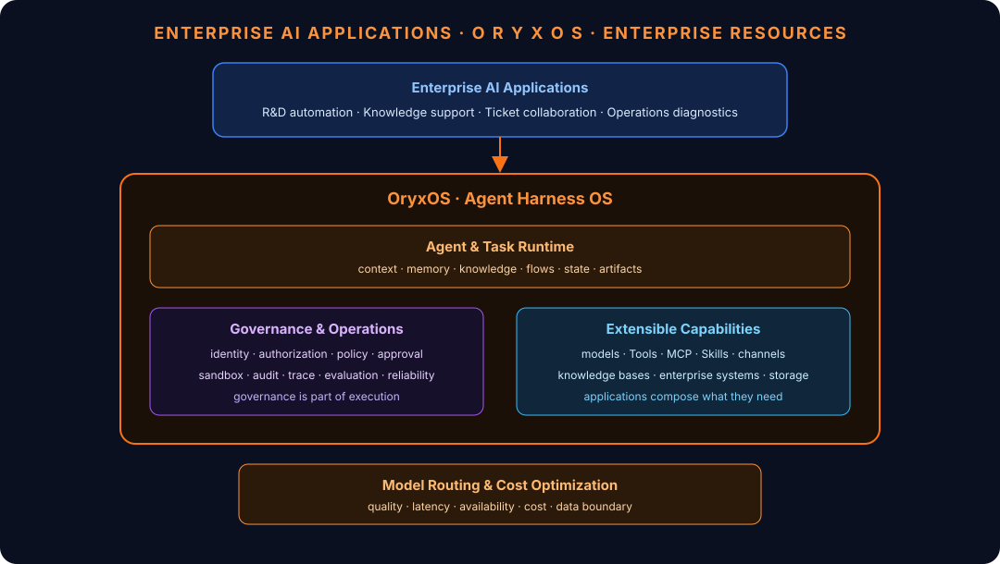

<p align="center">
  
</p>

<p align="center">
  <strong>Build enterprise AI applications. Govern every AI action.</strong><br/>
  <em>An open-source, self-hosted Agent Harness OS for the enterprise.</em>
</p>

<p align="center">
  <a href="https://github.com/oryx-labs/oryxos/releases"></a>
  <a href="https://modelcontextprotocol.io"></a>
  <a href="https://www.apache.org/licenses/LICENSE-2.0"></a>
</p>

<p align="center">
  <a href="README.md">English</a> · <a href="README.zh-CN.md">中文</a>
</p>

---

**OryxOS is an open-source, self-hosted Agent Harness OS for enterprise AI applications.** Build R&amp;D automation, knowledge support, ticket collaboration, operations diagnostics, and other domain applications on a shared runtime. Applications own their business rules, data, integrations, and user experience; OryxOS provides the shared runtime, governance, and operational optimization beneath them.

## What is OryxOS

OryxOS is the operating foundation for enterprise AI applications. Its direction is to give enterprises one place to **build, run, govern, and optimize** their own AI applications. Application teams compose Agents, models, Knowledge, Tools, MCP servers, and Flows to solve business problems; OryxOS supplies the execution semantics that make those applications consistent, extensible, and operable across the organization.

**Agent Harness OS** describes the shared Runtime and governance semantics around every Agent and Task.

Its core principle is simple: applications can freely compose capabilities, but they cannot bypass governance. Every Task runs through a common path for identity, authorization, policy, approval, model routing, Tool execution, audit, trace, cost attribution, and state updates.

```text
Task → Identity → Authorization → Policy → Approval
     → Model / Tool Execution → Audit / Trace / Cost → Artifact / State Update
```

## Architecture

<p align="center">
  
</p>

OryxOS is the shared foundation beneath enterprise AI applications: a stable kernel with extensible capabilities and a governance path that remains part of execution.

## Core platform capabilities

| Capability | What it provides |
| --- | --- |
| **Agent and Task Runtime** | A consistent lifecycle for Agent execution, context, sessions, memory, state, artifacts, and durable work. |
| **Model routing and cost optimization** | Selects models according to task requirements such as quality, latency, availability, cost, and data boundaries; evolves toward fallback, budgets, quotas, and organization-wide optimization. |
| **Knowledge and context** | Knowledge bases, retrieval, long-term memory, and extensible context assembly for business applications. |
| **Tools, MCP, and enterprise integrations** | Reusable capabilities for acting on enterprise systems through built-in Tools, MCP servers, Skills, channels, and custom extensions. |
| **Governance Runtime** | Identity, authorization, policy, approval, sandbox boundaries, and audit are part of the action path rather than after-the-fact reporting. |
| **Operations and reliability** | Traceability, cost attribution, evaluation, recovery, retries, observability, and the foundation for dependable production operation. |

## Why it matters

- **Build business applications, not infrastructure.** Teams focus on their domain while reusing a common AI runtime and capability layer.
- **Govern every AI action.** Models and Tools can be composed by applications, but policy, approval, audit, and security boundaries travel with execution.
- **Optimize as a system.** Routing, cost, trace, evaluation, and operational data become shared enterprise assets rather than isolated application concerns.

## Roadmap

**Available today — single-node runtime kernel**

Define and run Agents on your infrastructure with model Providers, Memory, Knowledge, built-in Tools, MCP, Skills, notifications, scheduling, sandbox controls, audit records, REST APIs, and a Web Manager.

**Evolving — enterprise execution foundation**

- **Durable Tasks** — stable lifecycle, checkpoints, artifacts, waiting, cancellation, retry, and recovery.
- **Model routing and cost optimization** — policy-aware routing, fallback, budgets, quotas, usage attribution, and data-boundary controls.
- **Governance Control Plane** — identity context, policy distribution, approval workflows, organization boundaries, and administrative lifecycle.
- **Operational intelligence** — cost analysis, trace analysis, evaluation, regression feedback, and cross-application optimization.
- **Distributed foundation and Flows** — shared storage, stateless instances, high availability, and governed workflow execution.

See the [Vision & Roadmap](docs/VisionAndRoadmap.md) for the evolving technical plan.

## Quick start

```bash
git clone https://github.com/oryx-labs/oryxos.git
cd oryxos
mvn package -DskipTests
bin/start.sh
```

The default setup starts with the built-in `mock` Provider and does not require an LLM API key. Open `http://localhost:8080/admin/` after startup.

For installation, deployment, provider configuration, API references, and development instructions, see [docs](docs/).

## Project

- License: [Apache License 2.0](LICENSE)
- Contribution: [CONTRIBUTING.md](CONTRIBUTING.md)
- Long-term aspiration: grow an open community and pursue incubation at the Apache Software Foundation.
