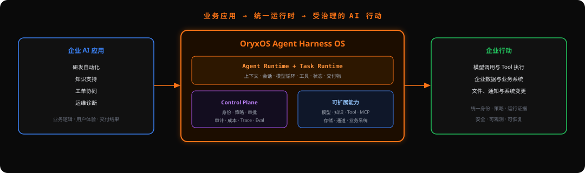
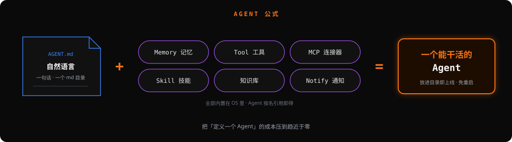
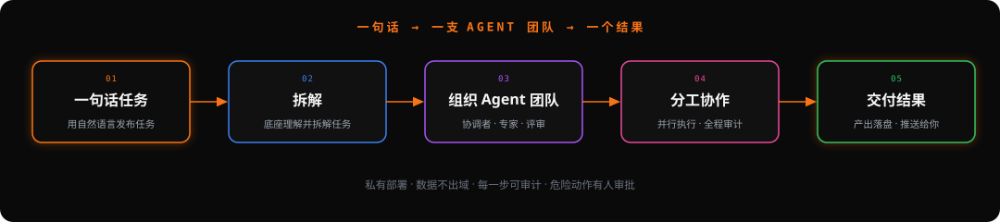
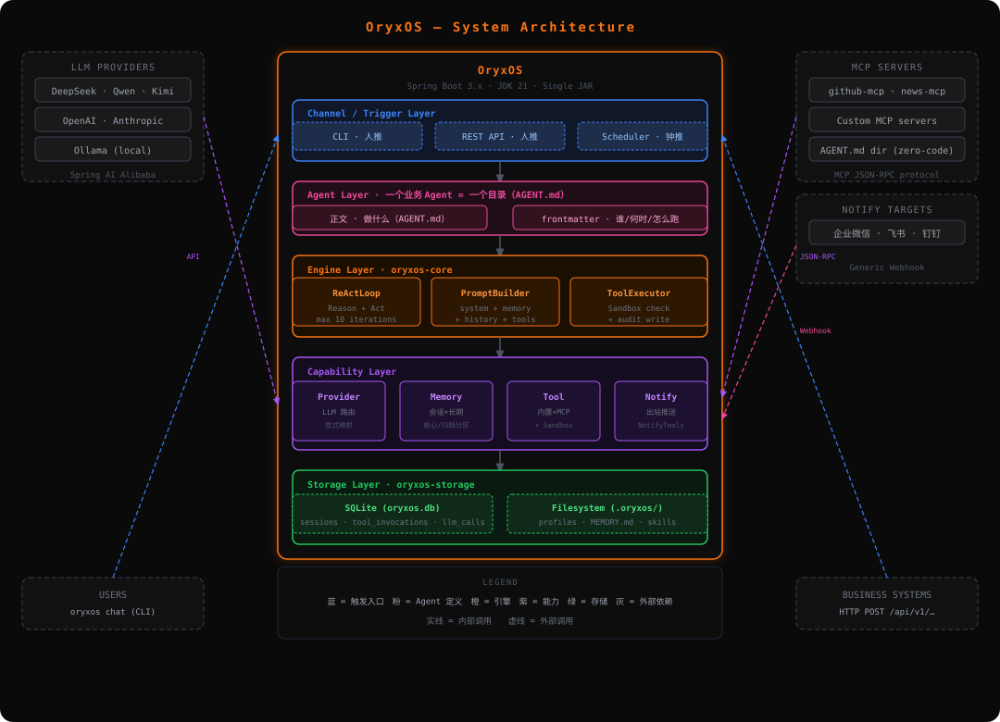
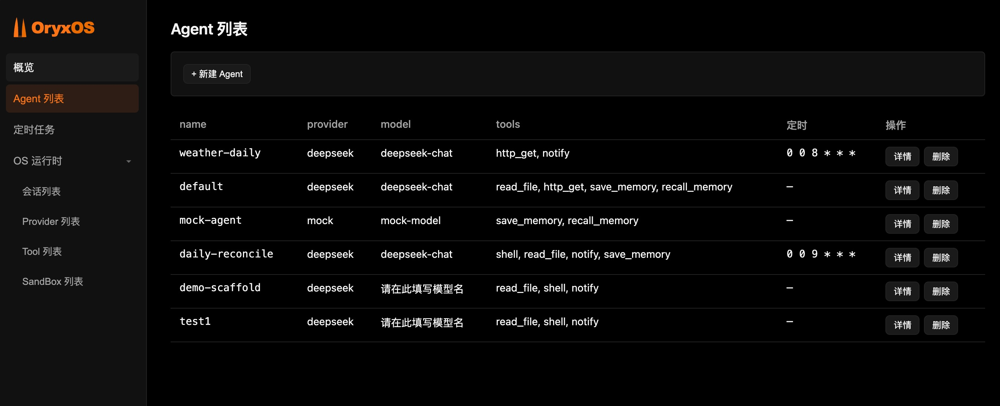

<p align="center">
  
</p>

<p align="center">
  <strong>构建企业 AI 应用，统一治理每一次 AI 行动。</strong><br/>
  <em>面向企业的开源 Agent Harness OS。</em>
</p>

<p align="center">
  <a href="https://github.com/oryx-labs/oryxos/releases"></a>
  <a href="https://modelcontextprotocol.io"></a>
  <a href="https://www.apache.org/licenses/LICENSE-2.0"></a>
</p>

<p align="center">
  <a href="README.md">English</a> · <a href="README.zh-CN.md">中文</a>
</p>

---

**OryxOS 是面向企业 AI 应用的开源 Agent Harness OS。** 企业可以在共享运行时上构建研发自动化、知识支持、工单协同、运维诊断和其他领域应用。应用负责业务规则、数据、系统集成和用户体验；OryxOS 提供统一的执行与治理底座。

<p align="center">
  
</p>

OryxOS 让应用团队专注业务结果，平台负责 AI Task 如何运行、Agent 如何获得能力，以及行动如何被治理、观察和持续改进。

- **当前可用**：通过一句话或一个 Markdown 目录定义 Agent，并在自己的基础设施上使用模型 Provider、Memory、Knowledge、内置 Tool、MCP、Skill、通知、调度、沙箱控制、审计记录、REST API 和 Web Manager。
- **发展方向**：让持久、受治理的 Task 成为企业 AI 应用的共同执行单元，持续增强恢复、审批、成本、评测和跨应用优化能力。参见[路线图](docs/VisionAndRoadmap.md)。

> 长期愿景：进入 Apache Software Foundation，发展为顶级项目。

## Agent 公式

Agent 所需的能力由 **OS 统一提供**，Agent 只需要声明要使用什么：

<p align="center">
  
</p>

这是一种务实的起点：**让定义 Agent 的成本趋近于零。** 你描述意图，Runtime 提供能力、安全边界和执行证据。

## 什么是 Agent Harness（以及为什么是 OS）

**Agent Harness 是围绕模型的运行支架，它将模型变成可以工作的 Agent：** 驱动理解、行动、观察循环；提供可调用的 Tool 与执行环境；在每次模型调用前组装上下文；积累记忆；限制沙箱范围；记录完整审计轨迹。裸模型只能生成文本，Harness 才让它能够可靠、安全地执行工作。

**可靠的企业 AI 的瓶颈不只在模型，也在模型周围的 Harness 和治理行动的 Runtime。** OryxOS 为每个 Agent 提供一致的执行环境，为每个应用提供统一的 Task、能力、策略、审计和可观测语义。这就是 **Agent Harness OS**。

### 受治理的执行链路

OryxOS Task 将业务上下文与模型、Tool 执行连接起来。治理是 Runtime 链路的一部分，而不是事后追加的一份报表：

```text
Task -> Identity -> Authorization -> Policy -> Approval
     -> Model / Tool Execution -> Audit / Trace / Cost
     -> Artifact / State Update
```

当前的 Agent 团队流程仍然可以用来说明 Task 如何拆解和交付。团队编排和更广泛的多 Agent 协作属于持续演进能力，不是当前产品定义的全部：

<p align="center">
  
</p>

## Model → Harness → OS

| | 裸模型 | Agent Harness | Agent Harness OS |
| --- | --- | --- | --- |
| 范围 | 一次 LLM 调用 | **一个**可靠的 Agent | 企业应用及其 **Task** |
| 提供 | 文本生成 | 循环、Tool 与执行、上下文、记忆、沙箱、审计、交付 | Task 生命周期、通道、路由、共享注册表、调度、治理、管理和 API |
| 类比 | CPU 指令 | 带运行时的进程 | 运行多个进程的操作系统 |

OryxOS 位于第三列：为运行其中的每个 Agent 和应用提供共享 Runtime 与治理能力。

## Features

下面的功能列表描述当前的单节点 Runtime，除非明确标记为 **演进中** 或 **探索中**。项目定位比当前实现更广：OryxOS 正在建设面向企业 AI 应用的共享 Agent Runtime、Task Runtime 和 Control Plane。

**🤖 一个目录 = 一个 Agent**
Agent 是 `.oryxos/agents/<name>/AGENT.md` 目录：包含 YAML frontmatter 和任务指令。可选的 `skills/` 目录通过相对符号链接绑定共享 Skill。每次提示词只接收已绑定 Skill 的名称、描述和本地路径，正文与资源按需加载。一个实例可以运行多个 Agent。

**⚡ 动态 Agent 管理**
可以通过 REST 创建 Agent，用一句话让 LLM 生成 `AGENT.md` 草稿，或在维护窗口更新工作区目录。单节点模式使用 `WorkspaceWatcher`；集群模式通过版本轮询和定期协调，在不重启的情况下重新加载定义。

**📦 单二进制，开箱即用**
单个可执行产物包含自主实现、可检查的 ReAct Loop，以及基于虚拟线程的同步执行。执行 `bin/oryx-server start` 即可同时启动 REST API、Web Console、调度器和沙箱，不需要额外 Runtime 或 sidecar。

**🔒 私有与合规**
可运行在自己的 K8s、VM 或裸机上。数据不离开企业环境，不锁定云厂商。凭证通过环境变量和企业密钥管理系统提供。

**🔀 动态 Provider 注册表**
LLM Provider 和通知渠道存储在 SQLite 中，支持完整 CRUD，可在运行时添加、编辑或删除。显式的 `name → ChatModel` 路由保持多 Provider 调度正确；密钥或 base URL 变化时，模型会重新构建并缓存。组织级路由和优化策略属于**演进中**能力。

**🛡️ 安全是基础能力**
Tool 调用经过文件路径、命令和域名白名单检查。每次 Tool 调用和 LLM 调用都写入审计表，而不只是写日志。身份感知的策略、审批和更完整的 Control Plane 语义属于**演进中**能力。

**🔌 开放标准**
通过 MCP 接入 Tool，支持三层扩展模式（零代码 `SKILL.md` → 自定义 MCP Server → 原生 `@Tool`）。通知渠道按名称寻址。Agent 间协作和更广泛的生态互操作属于**探索中**能力。

## Architecture

<p align="center">
  
</p>

当前架构图展示的是单节点 Runtime。目标平台模型将企业应用与 OryxOS 共享服务分开：Agent Runtime 执行 Context、Session、模型轮次和 Tool；Task Runtime 管理持久工作与交付物；Control Plane 协调身份、策略、审批、审计、成本和评测。这些层的建设进度不同，因此下面的路线图会区分可用能力和仍在建设中的能力。

## Five Core Capabilities

| 能力 | 状态 | 说明 |
| --- | --- | --- |
| **LLM Routing** | 可用 | 基于 SQLite 的动态 Provider 注册表，支持 CRUD。Agent 与 Provider 解耦，通过显式名称到模型的路由保证多 Provider 调度正确，可在运行时切换或添加 Provider，也支持本地推理。组织级路由优化属于演进中能力。 |
| **ReAct Loop** | 可用 | 自主实现的推理引擎，不依赖外部框架。模型决定是否以及调用哪个 Tool，OryxOS 执行并回填结果，继续当前轮次。基于虚拟线程同步执行，循环完全可控。 |
| **Memory** | 可用 | 每个 Agent 的长期记忆位于 `.oryxos/agents/<name>/MEMORY.md`，按时间记录；没有 Agent 上下文时使用全局记忆。记忆自动注入系统提示词。配置 `embedding.*` 后可使用向量、关键词和时间近度检索。 |
| **Knowledge** | 可用 | 命名知识库位于 `.oryxos/knowledge/<name>/`，支持切分、Embedding 索引、混合检索、引用、热加载和管理台生命周期。后端契约可扩展到企业存储。 |
| **Tool System** | 可用 | 内置文件、Shell 和 HTTP Tool。三层扩展：零代码 `SKILL.md` 和 MCP Server → 自定义 MCP Server → 原生 `@Tool` 方法。执行包含沙箱边界和审计记录。 |
| **REST API** | 可用 | Runtime 能力通过 REST 暴露，任何语言的应用和业务系统都可以接入。持久 Task API、更完整的治理 API 和 SDK 属于演进中能力。 |

## Roadmap

**可用 — 单节点 Runtime Kernel** ✅
通过一句话或一个目录定义 Agent，无需重启即可生效。单节点已经支持 Memory、内置 Tool、MCP、Skill、通知、调度、沙箱控制、审计记录、REST API 和 Web Manager。

**演进中 — 共享 Task Runtime 与 Control Plane**（参见 [Vision & Roadmap](docs/VisionAndRoadmap.md)）

- **A · 持久 Task**：稳定的 Task 生命周期、Checkpoint、交付物、等待、取消、重试和恢复语义
- **B · 治理 Control Plane**：身份上下文、策略分发、审批流程、组织边界和管理生命周期
- **C · 成本与质量运营**：跨应用成本归集、预算、Trace 分析、评测和回归反馈
- **D · 分布式基础**：共享存储、无状态实例、调度、高可用和多节点运行
- **E · Flow 编排**：声明式步骤、依赖、超时、补偿和受治理的外部副作用

**探索中 — 生态与应用方向**

- **F · 跨应用优化**：跨应用共享路由、能力目录、评测集和运行经验
- **G · 受治理的多 Agent 系统**：建立在稳定 Task 和 Policy 语义上的规划者、专家、评审者与 A2A 协作
- **H · 生态互操作**：跨 Runtime、身份系统和执行环境的可移植扩展与开放集成
- **I · 企业 AI 应用示例**：研发自动化、知识支持、工单协同和运维诊断的可复用模式

## Module Structure

```text
oryxos/
├── oryxos-core          # OryxTool、Session、ReActLoop、PromptBuilder、ToolExecutor、AgentScheduler
├── oryxos-persona       # Persona 预设目录（12 个内置）与用户自定义 Persona CRUD
├── oryxos-provider      # ProviderService、Function Calling 适配、显式多 Provider 映射
├── oryxos-memory        # MemoryService、LongTermMemory、MemoryTools（save/recall）
├── oryxos-knowledge     # 知识库：本地后端插件、切分/Embedding/索引流水线、混合检索
├── oryxos-tool          # 内置 Tool（file/shell/http）、MCP Client、ToolRegistry、SandboxChecker
├── channels/            # Channel 适配器，由 oryxos-channels 聚合
│   ├── oryxos-channel-cli       # CLI Channel：oryxos chat
│   ├── oryxos-channel-feishu   # 飞书入站 Channel（长连接）
│   ├── oryxos-channel-wecom    # 企业微信智能机器人入站 Channel
│   ├── oryxos-channel-dingtalk # 钉钉 Stream 入站 Channel
│   ├── oryxos-channel-slack    # Slack 入站 Channel（Socket Mode）
│   ├── oryxos-channel-discord  # Discord 入站 Channel（Gateway）
│   ├── oryxos-channel-telegram # Telegram Bot 入站 Channel
│   ├── oryxos-channel-whatsapp # WhatsApp 入站 Channel
│   ├── oryxos-channel-teams    # Microsoft Teams 入站 Channel
│   ├── oryxos-channel-gchat    # Google Chat 入站 Channel
│   ├── oryxos-channel-mattermost # Mattermost 入站 Channel
│   ├── oryxos-channel-matrix   # Matrix 入站 Channel
│   ├── oryxos-channel-qq       # QQ 官方 Bot 入站 Channel
│   ├── oryxos-channel-douyin   # 抖音 OpenAPI 入站 Channel
│   ├── oryxos-channel-weixin   # 微信 iLink Bot 入站 Channel
│   ├── oryxos-channel-weixin-kf # 微信客服入站 Channel
│   ├── oryxos-channel-weixin-mp # 微信公众号入站 Channel
│   ├── oryxos-channel-weixin-mini # 微信小程序入站 Channel
│   └── oryxos-channel-alipay   # 支付宝生活号入站 Channel
├── oryxos-web           # REST API Controller、Web 管理台、GlobalExceptionHandler
├── oryxos-storage       # SQLite、SessionRepository、ToolInvocationRepository、LlmCallRepository
├── oryxos-cli           # Picocli 入口、12 个子命令、ConfigLoader
└── oryxos-boot          # Spring Boot 主类、自动配置、依赖聚合
```

各模块通过接口解耦。增加新的 Channel 或 Tool 只需要新增模块，不需要修改 `oryxos-core`。

## Quick Start

**前置条件**：Java 21 和 Maven 3.9+。默认本地配置使用内置 `mock` Provider，无需 LLM API Key。Maven 首次构建会安装本地 Node.js 来打包管理台，不要求全局 Node.js。

**最快方式 — [SDKMAN!](https://sdkman.io/)**（推荐）：仓库提供 `.sdkmanrc`，固定 JDK 和 Maven 版本。安装 SDKMAN 后，在 `~/.sdkman/etc/config` 开启 `sdkman_auto_env=true`，然后执行：

```bash
cd oryxos
sdk env install    # 安装 .sdkmanrc 声明的 JDK 和 Maven 版本
```

之后进入项目目录会自动切换工具链。如果希望自行通过 `apt`、`brew` 或压缩包安装 Java 和 Maven，请确认 `java -version` 为 21+，`mvn -version` 为 3.9+。

**Windows**：内置工作区存储需要原生 POSIX 文件系统，请在 WSL2（Ubuntu）中启动服务。将仓库克隆到 Linux home 目录，例如 `~/oryxos`；位于 `/mnt/d/...` 等 Windows 驱动器的 checkout 仍然是 NTFS，会触发相同的启动检查。也可以使用 WSL2 中的 Docker。

### 1 · 构建

```bash
git clone https://github.com/oryx-labs/oryxos.git
cd oryxos
mvn package -DskipTests          # 编译所有模块并将 Vue 管理台打包进 fat JAR
```

### 2 · 可选：配置外部 Provider

```bash
cp config/application.yml.example config/application.yml
export DEEPSEEK_API_KEY=your-key-here
# 取消 config/application.yml 中 deepseek 配置的注释，并设置 author.provider: deepseek
```

示例默认使用 `mock`，启动不需要 Provider Key。使用外部 Provider 时，请将 Key 保存在环境变量或部署 Secret 中，并在 Provider seed 中通过 `${DEEPSEEK_API_KEY:}` 引用。不要把密钥直接写进 YAML。示例配置已被 gitignore 忽略，但这不意味着可以在其中保存凭证。

### 3 · 一键启动 — Server + Manager

```bash
bin/start.sh                     # 默认端口 8080，也可以执行 bin/start.sh 9000
bin/stop.sh                      # 停止
```

`start.sh` 启动一个同时提供 REST API 和 Web Manager 的进程，等待健康检查通过后打印 URL（`/api/v1/health`、`/admin/`、`/swagger-ui`）。日志写入 `logs/oryxos.log`。首次启动会从无 Key 模板创建 `config/application.yml`，并使用 `mock` Provider。

Provider YAML 只会为数据库中不存在的 Provider 提供 seed。完成 seed 后，加密数据库中的注册表是权威来源；修改环境变量或 YAML 不会轮换已有 Provider。请通过管理台或 `PUT /api/v1/providers/{name}` 添加或轮换凭证。生产环境请备份并保持 `ORYXOS_MASTER_KEY` 不变，否则已有凭证可能无法解密。

### CLI 替代方式

```bash
JAR=oryxos-boot/target/oryxos-boot-*.jar
java -jar $JAR init                       # 初始化 .oryxos/ 工作区（agents/ memory/ sessions/ logs/）
# 使用外部 Provider 时，先在 config/application.yml 中添加环境变量占位 seed
export DEEPSEEK_API_KEY=your-key-here
java -jar $JAR chat --profile default      # 交互式多轮聊天
java -jar $JAR serve --port 8080           # REST API + Web Manager（与 start.sh 相同）
```

工作区默认为 `.oryxos/`，也可以通过 `ORYXOS_ROOT`（或 `-Doryxos.root=`、`application.yml` 中的 `oryxos.root`）指定其他目录。选定的工作区根目录及其检查过的原生执行视图会自动加入文件沙箱白名单。共享部署使用 `shared-posix` Provider 和预置的 `.workspace-id`；插件要求、冲突处理、输出隔离和恢复流程见[共享工作区指南](docs/SharedVolumeGuide.md)。

### Docker 替代方式

每个版本都会在 GHCR 发布多架构容器镜像（`linux/amd64` + `linux/arm64`），无需安装 Java 21 或下载压缩包：

```bash
docker run -d --name oryxos -p 8080:8080 -v oryxos-data:/data ghcr.io/oryx-labs/oryxos:latest
curl http://localhost:8080/api/v1/health      # -> {"code":0,...}
```

容器无需 Key 即可启动（之后在 Web Manager 中配置 Provider），并将 `config/`、`.oryxos/` 工作区、`oryxos.db` 和日志全部保存在 `/data` 卷中。镜像以非 root 用户运行，并内置访问 `/api/v1/health` 的 healthcheck。仓库根目录的 `docker-compose.yml` 提供可直接使用的 compose 配置。本地构建镜像可执行 `make docker`（先执行 `make build`）。

> 上例使用默认 SQLite，请只运行一个容器。多副本部署需要共享 PostgreSQL 和共享工作区，参见 [K8s 部署指南](docs/K8sDeployGuide.md) 与[共享卷要求](docs/SharedVolumeGuide.md)。本地 kind 验证不代表跨主机存储 HA；[042 验收记录](specs/042-workspace-storage/acceptance.md)仍保留该验证项。

### Web Service 与 Web Manager

`serve`（以及 `bin/start.sh`）在同一个端口提供两个入口：

| URL | 说明 |
| --- | --- |
| `http://localhost:8080/api/v1/**` | REST API（见下文） |
| `http://localhost:8080/admin/` | **Web Manager** — Vue 3 管理台 |
| `http://localhost:8080/swagger-ui` | OpenAPI 文档 |

Web Manager 是 Vue 3 + Vite 管理台（与官网使用相同技术栈和深橙色主题），包含 **Agent 管理**（创建、用一句话生成、文件编辑、Agent 会话和记忆）、**Provider 和通知渠道 CRUD**、**定时任务**、**Session、Tool、沙箱白名单**以及**工作区文件浏览器**。它会构建到 `oryxos-web/src/main/resources/static/admin/`，由 Spring 在 `/admin` 提供，因此 fat JAR 不需要单独的前端进程即可包含管理台。

<p align="center">
  
</p>

#### Manager 开发模式（热更新）

开发管理台时，可以运行 Vite 开发服务器，而不必每次都重新构建 JAR：

```bash
# 1. 保持后端运行，开发服务器会将 API 代理到后端
bin/start.sh                              # REST API 在 :8080

# 2. 在另一个终端启动 Vite 开发服务器
cd oryxos-web/src/main/frontend
npm install                               # 首次运行
npm run dev                               # -> http://localhost:5173/admin/
```

开发服务器使用端口 **5173**，base 为 `/admin/`，并将 `/api` 代理到 `localhost:8080`（见 `vite.config.js`）。修改 `src/` 下文件会立即更新页面。完成后执行 `npm run build`，再运行 `mvn package` 即可将生产资源打进 fat JAR。

## Agent Definition

**一个目录 = 一个 Agent。** 每个 Agent 位于 `.oryxos/agents/<name>/`，包含 `AGENT.md`、可选脚本/参考资料和 `skills/` 绑定视图。共享 Skill 位于 `.oryxos/skills/<name>/`；Agent 通过 `agents/<agent>/skills/<name>` 下的相对符号链接绑定 Skill。每次 Prompt 只接收已绑定 Skill 的名称、描述和本地路径，正文和资源通过 `read_file` / `shell` 按需加载。

```markdown
---
name: ops-agent
description: DevOps assistant
identity:
  agent_name: ops-agent
  prompt: You are a professional DevOps assistant...
provider:
  name: deepseek          # 切换到 qwen / ollama / openai，无需改代码
  model: deepseek-chat
  api_key: ${DEEPSEEK_API_KEY}
tools:
  - shell
  - read_file
  - http_get
  - save_memory
  - recall_memory
schedules:
  - key: daily-brief
    name: Daily brief
    cron: "0 0 9 * * *"
    zone: Asia/Shanghai
settings:
  max_iterations: 10
  max_history_turns: 20
---

You are a professional DevOps assistant. When triggered, ... (task instructions)
```

省略或留空 `zone` 的 Schedule 统一使用 UTC。升级时如需保持旧系统时区的本地时间，请显式设置部署时区，例如 `zone: Asia/Shanghai`。单节点模式中，`WorkspaceWatcher` 会注册工作区变化而无需重启；集群模式请使用管理 API，直接修改文件需要停止写入方的维护窗口，并由定期协调发现。也可以通过 `POST /api/v1/agents` 创建 Agent，或在管理台用一句话生成草稿。

## REST API

所有 Endpoint 都以 `/api/v1` 为前缀，每个响应都使用统一 Envelope：`{ "code": 0, "message": "success", "data": <payload>, "timestamp": ... }`（错误时 `code` 非零）。认证可配置，默认关闭；在暴露受保护操作前，请为部署配置 Web 认证、API Key 和授权。

| 方法 | 路径 | 说明 |
| --- | --- | --- |
| `POST` `GET` | `/agents`, `/agents/{name}` | Agent CRUD（创建 / 列表 / 获取 / `PUT` 更新 / `DELETE` 归档） |
| `POST` | `/agents/{name}/invoke` | 无状态单轮调用 |
| `GET` | `/agents/{name}/memory` | Agent 长期记忆 |
| `GET` `POST` | `/agents/{name}/session`, `/agents/{name}/session/messages` | 管理台 Session 与发送消息 |
| `POST` | `/agents/{name}/generate-files` | 一句话 → LLM 生成 `AGENT.md` 草稿（仅预览） |
| `POST` | `/agents/{name}/files` | 保存 Agent 文件编辑结果 |
| `POST` `GET` | `/providers`, `/providers/{name}` | Provider CRUD（创建 / 列表 / 获取 / `PUT` / `DELETE`） |
| `POST` `GET` | `/notify-channels`, `/notify-channels/{name}` | 通知渠道 CRUD |
| `POST` `GET` | `/sessions`, `/sessions/{id}` | Session 创建 / 列表 / 历史 / `DELETE` 归档 |
| `POST` | `/sessions/{id}/messages` | 发送消息（触发 ReAct Loop） |
| `GET` `POST` `PUT` | `/schedules`, `/schedules/{id}/executions`, `/schedules/{id}/run`, `/schedules/{id}` | 列表 / 历史 / 立即运行 / 启用或禁用 |
| `GET` `POST` `DELETE` | `/sandbox/whitelist`, `/sandbox/whitelist/{category}` | 沙箱条目列表 / 添加 / 删除（`FILE`\|`SHELL`\|`HTTP`） |
| `GET` `POST` | `/workspace/tree`, `/workspace/file` | 工作区文件浏览器（读树 / 读文件 / 写文件） |
| `GET` | `/profiles` | 列出派生 Profile（每个 Agent 一个） |
| `GET` | `/tools` | 列出可用 Tool |
| `GET` | `/health`, `/info` | 健康检查 / Runtime 信息与 Provider 状态 |

## Design Principles

- **Platform before Agent** — 最重要的交付物不是某个强大的 Agent，而是让企业应用可靠运行的共享 Agent Runtime 和 Task Runtime
- **Governance is runtime semantics** — 身份、授权、策略、审批、审计、Trace 和成本沿着执行链路跟随模型与 Tool 行动
- **Stable kernel, open extensions** — 应用可以接入自己的模型、Tool、MCP Server、知识库、身份系统和工作流，同时不能绕开公共 Runtime 边界
- **Positioning is not implementation status** — Agent Harness OS 是目标平台模型，每项能力分别标记为可用、演进中或探索中
- **Self-implement the core** — 自主实现推理循环，协议适配复用成熟库，不重复造轮子
- **One directory = one Agent** — `AGENT.md` + Agent 本地 Skill 符号链接 + 可选脚本，而不是代码
- **Open standards** — 使用 MCP 接入 Tool，使用 A2A 进行协作，使用开放格式定义 Skill
- **Stateless instances** — 从一开始就将状态外置，为分布式扩展准备基础
- **Security as foundation** — 受控 Tool 来源、最小权限、强制沙箱、托管密钥加密存储和审计轨迹
- **Phased and disciplined** — 先建设最小完整 Runtime Kernel，每次架构升级都用真实使用数据验证

## Tech Stack

| 组件 | 选择 |
| --- | --- |
| 语言 / Runtime | Java 21（虚拟线程） |
| 框架 | Spring Boot 3.x |
| LLM 集成 | Spring AI（OpenAI 兼容协议转换 + 仅使用 `@Tool` Schema） |
| CLI | Picocli |
| 配置 | SnakeYAML |
| 持久化 | SQLite（默认）/ PostgreSQL（集群），Spring Data JPA；可插拔本地/共享 POSIX 工作区 |
| 日志 | Logback + SLF4J（结构化 JSON） |
| 构建 | Maven 多模块 |

## Contributing

欢迎提交第一个 PR，请先阅读[贡献指南](https://oryx-labs.github.io/oryxos/zh/docs/contributing)和 [GitHub 工作流入门](https://oryx-labs.github.io/oryxos/zh/docs/github-workflow)。

## Contact group


## License

[Apache License 2.0](LICENSE) · [oryx-labs](https://github.com/oryx-labs) · 目标：Apache Software Foundation 顶级项目
