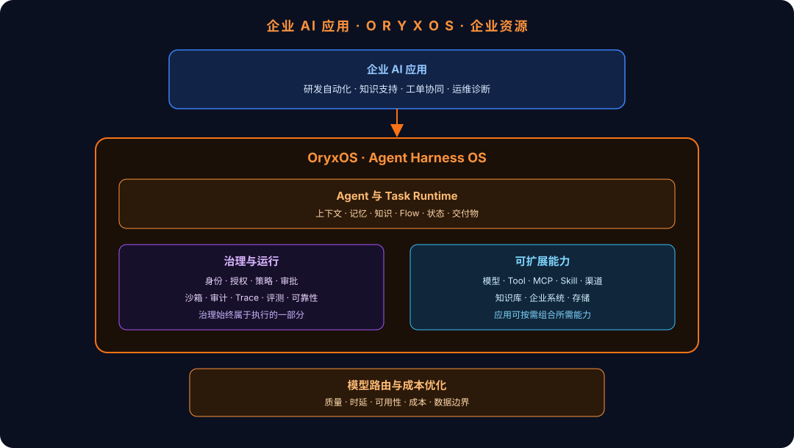

<p align="center">
  
</p>

<p align="center">
  <strong>构建企业 AI 应用，统一治理每一次 AI 行动。</strong><br/>
  <em>面向企业的开源、自托管 Agent Harness OS。</em>
</p>

<p align="center">
  <a href="https://github.com/oryx-labs/oryxos/releases"></a>
  <a href="https://modelcontextprotocol.io"></a>
  <a href="https://www.apache.org/licenses/LICENSE-2.0"></a>
</p>

<p align="center">
  <a href="README.md">English</a> · <a href="README.zh-CN.md">中文</a>
</p>

---

**OryxOS 是面向企业 AI 应用的开源、自托管 Agent Harness OS。** 企业可以在共享运行时上构建研发自动化、知识支持、工单协同、运维诊断和其他领域应用。应用负责业务规则、数据、系统集成和用户体验；OryxOS 提供其下方统一的 Runtime、治理与运行优化能力。

## OryxOS 是什么

OryxOS 是企业 AI 应用的运行底座。它的方向是让企业在同一套底座上**构建、运行、治理并持续优化**自己的 AI 应用。应用团队可以组合 Agent、模型、Knowledge、Tool、MCP Server 和 Flow，构建面向具体业务的问题解决方案；OryxOS 则提供统一的执行语义，让这些应用能够在企业中稳定运行、持续扩展并被统一管理。

**Agent Harness OS** 描述围绕每一个 Agent 与 Task 的共享 Runtime 和治理语义。

它的核心原则很简单：**应用可以自由组合能力，但不能绕过治理。** 每一个 Task 都运行在统一链路上，身份、权限、策略、审批、模型路由、Tool 执行、审计、Trace、成本归集和状态更新都属于执行的一部分。

```text
Task → Identity → Authorization → Policy → Approval
     → Model / Tool Execution → Audit / Trace / Cost → Artifact / State Update
```

## 整体架构

<p align="center">
  
</p>

OryxOS 是企业 AI 应用之下的共享底座：以稳定内核承载可扩展能力，并将治理持续地放在每一次执行链路中。

## 核心平台能力

| 能力 | 提供什么 |
| --- | --- |
| **Agent 与 Task Runtime** | 为 Agent 执行、上下文、会话、记忆、状态、交付物和持久任务提供一致的生命周期。 |
| **模型路由与成本优化** | 根据任务对质量、时延、可用性、成本和数据边界的要求选择模型；持续演进为降级、预算、配额和组织级优化能力。 |
| **知识与上下文** | 为业务应用提供知识库、检索、长期记忆和可扩展的上下文组装能力。 |
| **Tool、MCP 与企业系统接入** | 通过内置 Tool、MCP Server、Skill、渠道与自定义扩展，将可复用能力安全地连接到企业系统。 |
| **治理 Runtime** | 身份、授权、策略、审批、沙箱边界和审计进入行动路径，而不是事后附加的一份报告。 |
| **运行与可靠性** | Trace、成本归集、评测、恢复、重试、可观测性，以及面向生产稳定运行的基础。 |

## 有什么价值

- **让团队只关注业务。** 应用团队复用统一的 AI Runtime 与能力层，不必在每个应用里重复建设基础设施。
- **让每次 AI 行动可治理。** 应用可以组合模型与 Tool，但策略、审批、审计和安全边界始终随执行生效。
- **让系统级优化成为可能。** 模型路由、成本、Trace、评测和运行数据不再分散在各个应用中，而会沉淀为企业的共同资产。

## 路线图

**当前可用：单节点 Runtime 内核**

已经可以在自己的基础设施中定义和运行 Agent，并使用模型 Provider、Memory、Knowledge、内置 Tool、MCP、Skill、通知、调度、沙箱控制、审计记录、REST API 和 Web Manager。

**持续演进：企业应用执行底座**

- **持久 Task**：稳定的生命周期、Checkpoint、交付物、等待、取消、重试与恢复。
- **模型路由与成本优化**：面向策略的路由、降级、预算、配额、用量归集和数据边界控制。
- **治理 Control Plane**：身份上下文、策略分发、审批流程、组织边界和管理生命周期。
- **运行智能化**：成本与 Trace 分析、评测、回归反馈和跨应用优化。
- **分布式底座与 Flow**：共享存储、无状态实例、高可用和受治理的工作流执行。

完整演进计划见 [Vision & Roadmap](docs/VisionAndRoadmap.md)。

## 快速开始

```bash
git clone https://github.com/oryx-labs/oryxos.git
cd oryxos
mvn package -DskipTests
bin/start.sh
```

默认配置使用内置 `mock` Provider，无需 LLM API Key。启动后访问 `http://localhost:8080/admin/`。

安装、部署、Provider 配置、API 参考和开发说明请进入 [docs](docs/)。

## 项目信息

- 协议：[Apache License 2.0](LICENSE)
- 贡献：[CONTRIBUTING.md](CONTRIBUTING.md)
- 长期愿景：建设开放社区，并向 Apache Software Foundation 孵化发展。
